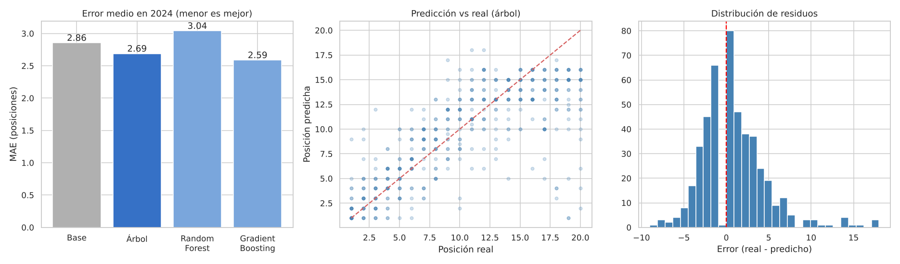
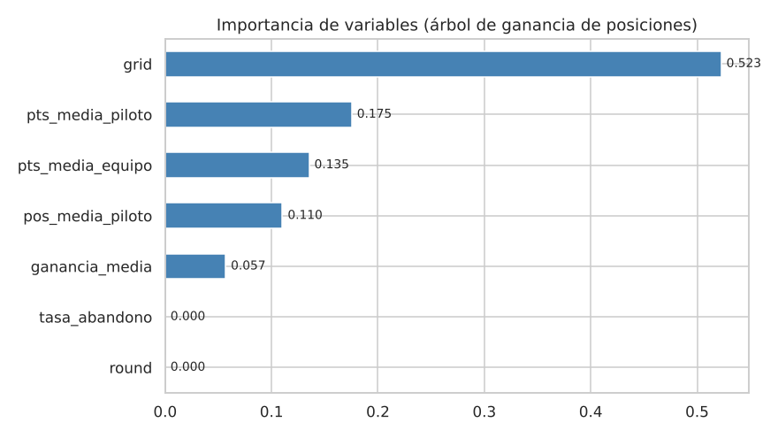

# 🏎️ Predicción de resultados de Fórmula 1 con árboles de decisión

Modelo de *machine learning* que predice la **posición final** de un piloto en una carrera de Fórmula 1 a partir de su posición de salida y de su forma reciente, entrenado con datos de la era del efecto suelo (2022-2024).

El foco del proyecto no es solo el modelo, sino hacerlo **bien**: validación temporal, variables sin fuga de datos y comparación con una referencia base.

## Resultados

Evaluación sobre la temporada **2024**, que el modelo no ve en el entrenamiento ni en la elección de hiperparámetros:

| Modelo | MAE (posiciones) | RMSE | R² |
|---|---|---|---|
| Referencia base (llega donde salió) | 2,86 | 4,19 | 0,47 |
| **Árbol de decisión** | **2,69** | **3,92** | **0,54** |
| Random Forest | 3,04 | 3,93 | 0,54 |
| Gradient Boosting | 2,59 | 3,75 | 0,58 |



**Lectura de los resultados**

- El árbol reduce el error medio un 6 % respecto a la referencia base y mejora el R² de 0,47 a 0,54.
- La mejora se concentra en los pilotos que salen **fuera del top 10** (MAE 2,90 frente a 3,23). En el top 10 no mejora la base (2,49 frente a 2,50).
- La posición de salida contiene la mayor parte de la información y la carrera añade mucho ruido (estrategia, safety cars, accidentes, fiabilidad), por lo que el modelo aporta una mejora moderada, no una predicción exacta.
- Gradient Boosting mejora algo más, a cambio de perder la interpretabilidad del árbol.

## Cómo está planteado

**Problema:** regresión supervisada. Variable objetivo: `positionOrder` (posición final, 1-20).

**Datos:** [Formula 1 World Championship 1950-2024](https://www.kaggle.com/datasets/rohanrao/formula-1-world-championship-1950-2020) (Kaggle). Solo se usan 2022-2024, porque el reglamento de efecto suelo de 2022 cambió la jerarquía competitiva.

**Variables** (todas calculadas únicamente con carreras *anteriores* a la que se predice):

| Variable | Descripción |
|---|---|
| `grid` | Posición de salida |
| `pos_media_piloto` | Posición final media reciente del piloto (media móvil exponencial) |
| `pts_media_piloto` | Puntos medios recientes del piloto |
| `pts_media_equipo` | Puntos medios recientes por coche del equipo |
| `tasa_abandono` | Proporción de abandonos previos |
| `ganancia_media` | Posiciones ganadas de media respecto a la salida |
| `round` | Número de carrera de la temporada |

La media móvil exponencial da más peso a las carreras recientes, lo que permite captar la evolución de pilotos y equipos.

**Modelo:** `DecisionTreeRegressor` que predice la *ganancia* de posiciones (`posición final - salida`). La predicción final es `salida + ganancia predicha`. Usa `criterion='absolute_error'`, coherente con evaluar con MAE. Los hiperparámetros (`max_depth`, `min_samples_leaf`) se eligen entrenando con 2022 y validando con 2023.

### Decisiones de validación

- **Partición temporal** (entrenamiento 2022-2023, test 2024) en lugar de una partición aleatoria, para simular el uso real de predecir una temporada nueva.
- **Sin fuga de datos:** las variables de cada carrera se calculan con `shift(1)`, de modo que el modelo nunca ve el resultado que intenta predecir.
- **Referencia base** ("acaba donde salió") para comprobar que el modelo aporta algo.
- **Abandono** definido como piloto no clasificado (≈12 %), no como cualquier estado distinto de "Finished".

### Interpretabilidad



## Escenario ilustrativo para 2025

El notebook incluye una simulación de la temporada 2025 (24 carreras, promediada sobre 100 temporadas simuladas) a partir del estado de cada piloto a finales de 2024 y de una parrilla simplificada de 2025, con tratamiento especial para cambios de equipo y debutantes.

> ⚠️ Es una demostración del modelo, **no está validada** con resultados reales de 2025 (el dataset llega hasta 2024). La medida de acierto del modelo es la de la tabla de resultados.

## Limitaciones

- El test es una sola temporada (468 filas), por lo que la diferencia con la referencia base tiene incertidumbre.
- No se incluyen datos de clasificación, clima, estrategia de neumáticos ni fiabilidad del coche.

## Estructura del repositorio

```
├── F1_Prediccion_2025.ipynb   # Análisis completo, con salidas ya ejecutadas
├── requirements.txt
├── modelo_f1_arbol.pkl        # Modelo entrenado
├── estado_2024.pkl            # Estado de pilotos y equipos a final de 2024
└── img/                       # Gráficos del notebook
```

## Cómo ejecutarlo

```bash
git clone <url-del-repositorio>
cd <carpeta>
pip install -r requirements.txt
```

1. Descarga los CSV del dataset de Kaggle (`results.csv`, `races.csv`, `drivers.csv`, `constructors.csv`) y colócalos junto al notebook.
2. Abre y ejecuta `F1_Prediccion_2025.ipynb`.

## Tecnologías

Python · pandas · NumPy · scikit-learn · matplotlib · seaborn · joblib · Jupyter
